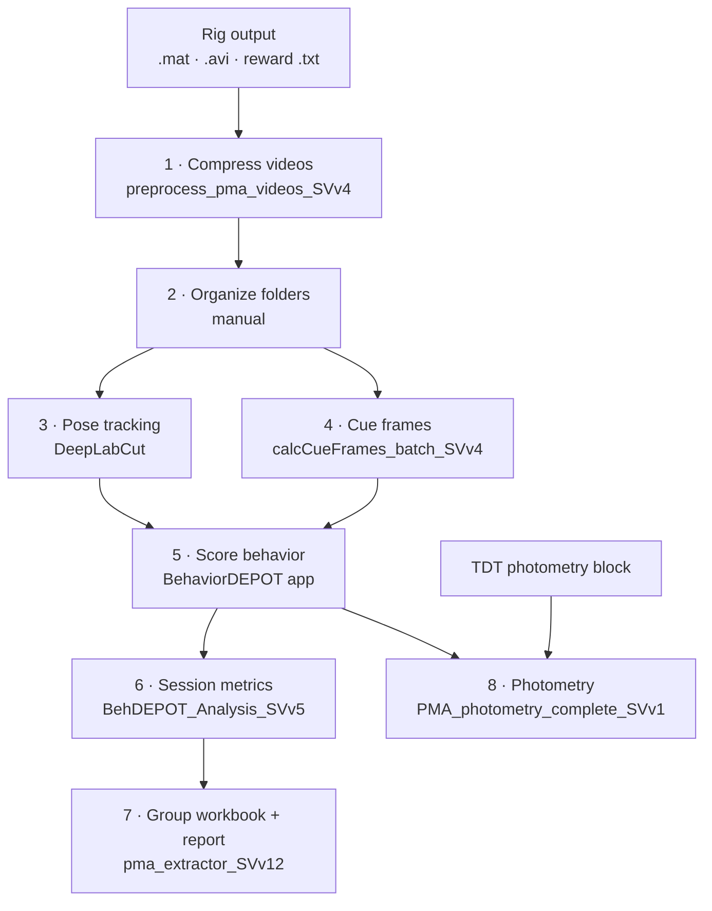

# Lab_Analysis_SV

MATLAB pipeline for **platform-mediated avoidance (PMA)** in mice. It takes behavior-rig video through pose tracking to per-tone platform and reward-zone behavior, then to a group Excel workbook and PDF reports. It also analyzes TDT fiber photometry. It was built for TMS vs. sham cohorts.

## Pipeline



Run the steps in order. Steps 3 and 4 can go in either order. Each script is driven by dialogs: press **Run** and pick folders. You don't need to pass arguments or edit the code.

`photometry/Photometry_Analysis_TMS_SVv8.m` is a separate tool for photometry recorded **during the TMS/sham stimulation sessions**. See [the last section](#tms-stimulation-photometry-photometry_analysis_tms_svv8).

## Requirements

| Requirement | Steps |
|---|---|
| Windows | all |
| MATLAB (developed on R2024b) | all |
| Statistics and Machine Learning Toolbox | 7 (required); 8, TMS (stats only) |
| Microsoft Excel, desktop version | 7 |
| [ffmpeg](https://www.gyan.dev/ffmpeg/builds/) 7+ (needs both `ffmpeg.exe` and `ffprobe.exe`) | 1 |
| [DeepLabCut](https://github.com/DeepLabCut/DeepLabCut) | 3 |
| [BehaviorDEPOT v1.6](https://github.com/DeNardoLab/BehaviorDEPOT) | 5 |
| [TDT MATLAB SDK](https://github.com/tdtneuro/TDTMatlabSDK) | 8, TMS |
| Python 3 + PyMuPDF (`pip install pymupdf`) | 8 (optional; merges the report into one linked PDF) |

## Setup

```matlab
addpath(genpath('C:\path\to\Lab_Analysis_SV'))   % this repo
addpath(genpath('C:\path\to\TDTMatlabSDK'))      % photometry only
```

For step 1, put ffmpeg on your PATH or unzip it anywhere inside `behavior\`. The script searches its own folder for it.

## Data layout

From step 4 onward, every script expects **one folder per animal per day**, grouped by condition:

```
<dataset root>\                              ← point steps 4, 6, 7, 8 here
├── sham_HabD1\                              <group>_<Day>, group = sham | tms
│   ├── PVFP_01_sham_HabD1_SV_Aug20\         one animal, one day
│   │   ├── <prefix>_<date>_<time>.mat                 rig file: tone/shock timing
│   │   ├── <prefix>_camera_<ts>_preprocessed.mp4      ← step 1
│   │   ├── <...>DLC_<network>_filtered.csv            ← step 3
│   │   ├── <prefix>_reward_data_<ts>.txt
│   │   ├── <session>_csp_cue_frames.csv               ← step 4
│   │   ├── <session>_analyzed\                        ← steps 5, 6
│   │   └── <session>_photometry\                      TDT block (photometry only)
│   └── PVFP_02_sham_HabD1_SV_Aug20\
├── tms_HabD1\
└── sham_TrainD1\ · tms_TrainD1\ · … · sham_Retr\ · tms_Retr\
```

**Rules that matter:**
- Each session folder holds exactly **one** `.mat`, **one** video and **one** DLC table at its top level. When there are several, scripts silently use the first one.
- Condition folders start with a lowercase `sham_` or `tms_`.
- Day names are `HabD1–3`, `TrainD1–3` and `Retr`.
- Subject IDs start with `PVFP_` or `DCSP_`.

Full rules and a step-by-step reorganization guide are in [docs/data_layout.md](docs/data_layout.md).

## Steps

### 1 · Compress videos: `preprocess_pma_videos_SVv4`
- **Point at:** the folder that contains the raw day folders (`HabD1\`, `TrainD1\`, …), each with every animal's files side by side.
- **Input, per session:** `<prefix>_<YYYY-MM-DD_HH-MM-SS>.mat`, `<prefix>_reward_data_*.txt` and `<prefix>_camera_*.avi`.
- **Output:** `<video>_preprocessed.mp4` next to the `.mat`. It keeps the same frames and frame rate, and adds a strip above the video with a timeline of tones, shocks and rewards.
- **Moves:** the original `.avi` goes to `<root>\og_large_vids\` after a successful encode.

### 2 · Organize folders: manual
Move each session's files into `<group>_<Day>\<SUBJECT>_<group>_<Day>_SV_<MonDD>\`. A session's group appears in its training-day filenames (`_Tms_` / `_Sham_`), but habituation filenames don't include it. See the [reorganization guide](docs/data_layout.md#reorganizing-a-raw-acquisition-dump).

### 3 · Pose tracking: DeepLabCut
- Run DeepLabCut on `*_preprocessed.mp4`.
- Leave only the `*_filtered.csv` in the session folder, and move the other DLC files into `quality_control\`.
- Track enough body parts for BehaviorDEPOT to compute **MidBack**. Left ear + right ear + tail base is enough.

### 4 · Cue frames: `calcCueFrames_batch_SVv4`
- **Point at:** the dataset root. Every session below it is listed, and sessions already done start unticked.
- **Input:** the rig `.mat` (`ts.camera_on`, `ts.csp_on/off`, `ts.us_on/off`, …) and the session video.
- **Output:** `<session>_csp_cue_frames.csv`, which holds the video frame numbers of each tone's onset and offset (N × 2, no header). It also writes `_us_` (shock), `_csm_` and `_laser_` files when those cues exist.
- **Modifies:** appends `cueframes` and `NumFrames` to the rig `.mat`.
- Cues that fall after the video ends are dropped. This happens when the camera stopped early.

### 5 · Score behavior: BehaviorDEPOT v1.6 (app)
Run **Data Prep** + **Behavior Analysis** on each session folder with these settings:

| Setting | Value |
|---|---|
| Classifier | Freezing |
| Spatial ROIs | `platform` and `reward`: exact, lowercase |
| Temporal event | name it `CSp` (not `CS+`) and select the session's `*_csp_cue_frames.csv` |
| Pixels per cm | set it (used for distance and speed) |

- **Output:** `<session>_analyzed\` containing `Behavior.mat` (freezing, ROI occupancy, tone bouts), `Tracking.mat`, `Metrics.mat` and `Params.mat`.

### 6 · Session metrics: `BehDEPOT_Analysis_SVv5`
- **Point at:** the dataset root. Then tick the condition folders to run, and confirm which ones are habituation days.
- **Input:** `*_analyzed\Behavior.mat`, `Tracking.mat` and `Params.mat`.
- **Output, in each `*_analyzed\`:** `Analysis_DT_platform.mat` and `Analysis_DT_reward.mat`, plus heatmap `.fig` files. Each file has an `Analysis` struct for that zone:

| Field | What it gives you |
|---|---|
| `CSp.OnPlatPerOnPlat` | fraction of each tone spent in the zone |
| `CSp.LatencyOnPlat` | seconds from tone onset to the first entry (0 = already in the zone, NaN = never entered) |
| `CSp.OnPlatSuccessfulTrial` | 1 if the animal was in the zone at the shock window at tone end. For `platform`, this is a **shock avoided**. |
| `CSp.FreezingPerFreeze` | fraction of each tone spent freezing |
| `ITI.OnPlatPer`, `ITI.first80` | fraction of each inter-tone interval (and of its first 80 s) spent in the zone |
| `CSp.DurOnPlat`, `ITI.DurOnPlat` | every visit: start frame, end frame, tone #, duration (s) |
| `Locomotion` | distance (cm) and speed (cm/s) for baseline, tones and ITIs |

### 7 · Group workbook + report: `pma_extractor_SVv12`
- **Point at:** the dataset root. Tick the conditions and the optional PDFs, then tick any animals to exclude.
- **Input:** `Analysis_DT_platform.mat` + `Analysis_DT_reward.mat` for each session.
- **Output, in the root:** `pma_extractor_combined_<timestamp>.xlsx`, plus optionally `pma_report_<timestamp>.pdf` and `ActivityMap_ByAnimal_<timestamp>.pdf`.

| Workbook tab | What it gives you |
|---|---|
| `all_tones` | one row per session: time on platform and at reward for each tone and ITI, shocks avoided, visit counts |
| `successful_trials` | proportion of shocks avoided by tone block (1–3, 4–6, 7–9, all) |
| `locomotion_timecourse` | distance and speed by tone block |
| `zone_visits_timecourse`, `zone_visits_prop` | platform and reward visit counts; reward-vs-platform preference |
| `zone_time_timecourse`, `zone_time_prop_*` | proportion of time in each zone by tone block |
| `stats` | binomial GLMM (avoidance ~ group × time) and paired tests with Holm correction |

- **Report PDF:** sham vs. TMS plots of shocks avoided, locomotion, time in zone and zone visits, followed by a stats page.
- **Activity Map PDF:** needs BehaviorDEPOT's *plot behavior locations* option to have been turned on in step 5.

### 8 · Photometry: `PMA_photometry_complete_SVv1`
At launch, choose **Run Batch Analysis** or **Compare Saved Traces**.

- **Point at:** the dataset root. Tick the day folders and choose single- or dual-color. Then pick behaviors and set the time windows.
- **Input, per session:**
  - `*_photometry\` (TDT block)
  - one rig `.mat`
  - `*_analyzed\Behavior.mat` (needs the `platform` ROI) and `Metrics.mat`
  - `*_csp_cue_frames.csv`
  - reward runs only: `*Reward*.csv`, an N × 2 frame table. This pipeline doesn't produce it.
- **Behaviors:**
  - platform entry vs. exit
  - tone onset on vs. off the platform
  - shocked vs. avoided tones (TRAIN days only)
  - reward

| Output | What it gives you |
|---|---|
| `<day>\Photometry_Results\<run>\<session>\*.mat` | `animal_result`: per-trial z-score matrix, mean trace and AUC for each channel and condition |
| `<day>\Photometry_Results\<run>\AUC_Exports\` | AUC per animal and per trial (`.csv`, `.xlsx`), plus wide CSVs ready for Prism |
| `<day>\Photometry_Results\<run>\run_parameters.txt` | settings used; they're also encoded in the `<run>` folder name, so reruns never overwrite |
| `<root>\PhotometryReport_<date>.pdf` | for each behavior and day: TMS vs. sham mean ± SEM traces, AUC per animal, stats pages, per-animal QC |
| `<root>\Photometry_Comparisons\<A>__vs__<B>_<time>\` | Compare mode: overlay of two saved traces, per-animal tiles, AUC stats, CSVs |

**Signal processing:**
- The isosbestic channel (405/415) is fit to the 465 (and 560) signal by least squares, and the fit is subtracted.
- Each trial is z-scored to its baseline window. The baseline window counts from the start of the trace window, while the AUC window is relative to the event.
- AUC is in z·s.

## TMS stimulation photometry: `Photometry_Analysis_TMS_SVv8`
This tool is separate from steps 1–8. It analyzes photometry recorded during TMS/sham stimulation, comparing session 1 with session 10.

- **Point at:** a folder of TDT blocks named `<SUBJ>\` (session 1) and `<SUBJ>_tenth\` (session 10). The TMS train channel is detected automatically, and you confirm it.
- **Output, in that folder:** `TMS_GroupSummary_<folder>_<timestamp>.pdf`, `.mat` and `_runlog.txt`.
  - **PDF:** for each channel, TMS vs. sham train-aligned traces and AUC (0–4, 4–8 and 0–8 s) for session 1 vs. 10. It also has whole-session AUC in 2-minute bins, plus QC and stats pages.
  - **`.mat`:** per subject, session and channel: trial z-scores, AUCs and the corrected trace.
- **Moves:** if you accept the proposed rename plan, the TDT block folders are moved into `<Group><1|10>\` folders, and a manifest CSV is written so the move can be undone.

## Credits
- [BehaviorDEPOT](https://github.com/DeNardoLab/BehaviorDEPOT) (Gabriel et al., *eLife* 2022), [DeepLabCut](https://github.com/DeepLabCut/DeepLabCut) and the [TDT MATLAB SDK](https://github.com/tdtneuro/TDTMatlabSDK) are separate projects and are not included here.
- The whole-session photometry analysis follows Gongwer et al., *Cell* 2026.

<!-- TODO before going public: credit the original author ("BK") of the photometry tool in photometry/ and the author of behavior/calc_time_plat.m and behavior/boutavg.m. -->

## License
[MIT](LICENSE) © 2026 Sam Vaillancourt
